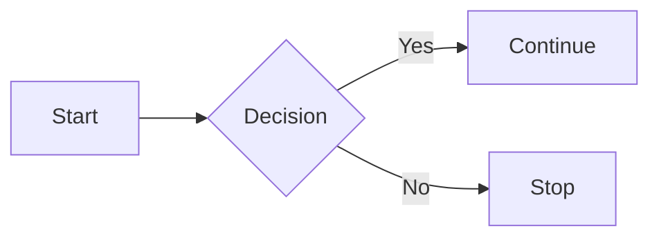

# Markdown Guide

<!-- to preview the MD file press ctrl+k then press v -->

Markdown is a lightweight text format for adding headings, lists, links, tables, and other formatting to plain text.

---

## 1. Headings

Use one to six hash symbols (`#`) followed by a space.

```markdown
# Heading 1

## Heading 2

### Heading 3

#### Heading 4

##### Heading 5

###### Heading 6
```

# Heading 1

## Heading 2

Alternative syntax for the first two heading levels:

```markdown
# Heading 1

## Heading 2
```

---

## 2. Paragraphs and Line Breaks

Separate paragraphs with a blank line.

```markdown
This is the first paragraph.

This is the second paragraph.
```

Create a line break with two trailing spaces:

```markdown
First line.  
Second line.
```

<br> also creates a line break, although raw HTML support varies.

```markdown
First line.<br>Second line.
```

---

## 3. Emphasis

```markdown
_Italic text_
_Also italic_

**Bold text**
**Also bold**

**_Bold and italic_**
**_Also bold and italic_**

~~Strikethrough~~
```

_Italic text_

**Bold text**

**_Bold and italic_**

~~Strikethrough~~

---

## 4. Blockquotes

Use `>` before a quote.

```markdown
> This is a blockquote.
>
> This is another paragraph inside the quote.
```

> This is a blockquote.
>
> This is another paragraph inside the quote.

### Nested blockquote

```markdown
> Outer quote
>
> > Inner quote
```

---

## 5. Lists

### Unordered list

```markdown
- Item one
- Item two
  - Nested item
  - Another nested item
- Item three
```

- Item one
- Item two
  - Nested item
  - Another nested item
- Item three

You may also use `*` or `+` instead of `-`.

### Ordered list

```markdown
1. First item
2. Second item
3. Third item
   1. Nested item
   2. Another nested item
```

1. First item
2. Second item
3. Third item
   1. Nested item
   2. Another nested item

### Task list

```markdown
- [x] Completed task
- [ ] Incomplete task
- [ ] Another task
```

- [x] Completed task
- [ ] Incomplete task
- [ ] Another task

### Definition list

Support varies by Markdown renderer.

```markdown
Term
: Definition

Another term
: Another definition
```

---

## 6. Links

### Inline link

```markdown
[Open Google](https://google.com)
[Open Google with title](https://google.com "Google")
```

[Open Google](https://google.com)

### Automatic link

```markdown
https://example.com
<https://example.com>
```

### Reference-style link

```markdown
[GitHub][github-link]

[github-link]: https://github.com "GitHub"
```

### Link to a heading

```markdown
See the [Lists section](#5-lists)
```

### Relative file link

```markdown
[Read the README](README.md)
```

### Image with link

```markdown
[](https://example.com)
```

---

## 7. Images

```markdown


```

For a remote image:

```markdown

```

---

## 8. Code

### Inline code

```markdown
Use the `npm install` command.
```

Use the `npm install` command.

### Fenced code block

````markdown
```javascript
const message = "Hello";
console.log(message);
```
````

```javascript
const message = "Hello";
console.log(message);
```

### Indented code block

Indent four spaces or one tab.

```markdown
    const number = 42;
    console.log(number);
```

---

## 9. Escaping Characters

Use a backslash to escape Markdown characters.

```markdown
\*Literal asterisks\*
\# Not a heading
\[Not a link\]
```

\*Literal asterisks\*

\# Not a heading

\[Not a link\]

Common escapable characters:

```text
\   `   *   _   { }   [ ]   < >   ( )   #   +   -   .   !   |
```

---

## 10. Horizontal Rules

```markdown
---
---

---
```

---

## 11. Tables

```markdown
| Name  | Role   | Active |
| ----- | ------ | ------ |
| Alice | Admin  | Yes    |
| Bob   | Member | No     |
```

| Name  | Role   | Active |
| ----- | ------ | ------ |
| Alice | Admin  | Yes    |
| Bob   | Member | No     |

### Aligned columns

```markdown
| Left | Center | Right |
| :--- | :----: | ----: |
| A    |   B    |     C |
| D    |   E    |     F |
```

| Left | Center | Right |
| :--- | :----: | ----: |
| A    |   B    |     C |
| D    |   E    |     F |

Alignment symbols:

- `:---` = left
- `:---:` = center
- `---:` = right

---

## 12. Footnotes

Support varies by Markdown renderer.

```markdown
This statement needs a reference.[^1]

[^1]: This is the footnote text.
```

---

## 13. Superscript and Subscript

Support varies by renderer.

```markdown
H~2~O

X^2^
```

Using HTML for broad compatibility:

```markdown
H<sub>2</sub>O

X<sup>2</sup>
```

---

## 14. Highlights

Support varies by renderer.

```markdown
==Highlighted text==
```

---

## 15. HTML in Markdown

Many Markdown renderers allow HTML:

```markdown
<u>Underlined text</u>

<kbd>Ctrl</kbd> + <kbd>C</kbd>

<details>
<summary>Click to expand</summary>

Hidden content goes here.

</details>
```

<u>Underlined text</u>

<kbd>Ctrl</kbd> + <kbd>C</kbd>

<details>
<summary>Click to expand</summary>

Hidden content goes here.

</details>

---

## 16. Comments

```markdown
<!-- This comment is not displayed in the rendered output -->
```

---

## 17. Emojis

```markdown
Smile: :smile:
Check: :white_check_mark:
Warning: :warning:
Rocket: :rocket:
```

GitHub renders emoji shortcodes; plain Unicode also works:

```markdown
😀 ✅ ⚠️ 🚀
```

---

## 18. Diagrams

Support depends on the platform. GitHub supports Mermaid diagrams in fenced blocks.



---

## 19. Mathematics

Support depends on the renderer.

```markdown
Inline: $E = mc^2$

Block:

$$
x = \frac{-b \pm \sqrt{b^2 - 4ac}}{2a}
$$
```

---

## 20. Table of Contents

```markdown
- [Headings](#1-headings)
- [Paragraphs and Line Breaks](#2-paragraphs-and-line-breaks)
- [Lists](#5-lists)
- [Links](#6-links)
- [Code](#8-code)
```

---

## 21. Complete Example

````markdown
# Project Title

> A short project description.

## Features

- [x] User authentication
- [ ] Password recovery
- [ ] Dark mode

## Installation

```bash
npm install
npm start
```

## Usage

Call the function with `runTask()`:

```javascript
runTask("Learn Markdown");
```

## API

| Method | Endpoint | Description       |
| ------ | -------- | ----------------- |
| GET    | `/tasks` | Get all tasks     |
| POST   | `/tasks` | Create a new task |

## Links

- [Documentation](docs/README.md)
- [Issue Tracker](https://example.com/issues)

---

Created with Markdown.
````

---

## Markdown Tips

1. Leave blank lines around headings, lists, blockquotes, tables, and code blocks.
2. Use consistent bullet and heading styles.
3. Use descriptive link text instead of raw URLs when possible.
4. Always add alt text to images.
5. Preview the document because feature support differs between Markdown processors.
6. Use fenced code blocks instead of relying on indentation.
7. Avoid unnecessary raw HTML; it is not supported everywhere.
8. Use one sentence per line for easier diffs in Git.
